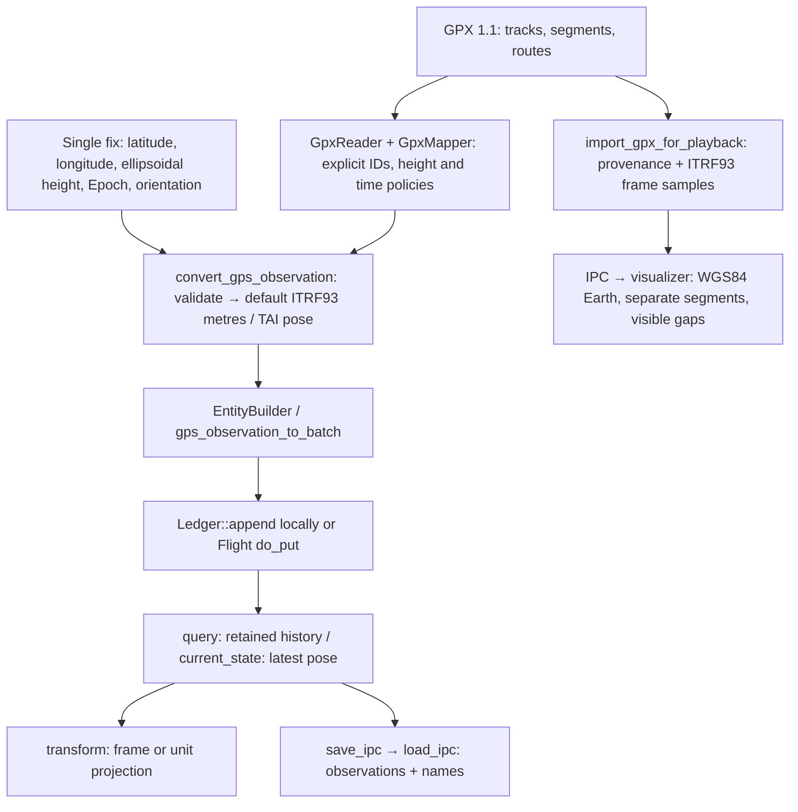

# soloc-ledger

**The append-only store at the heart of [soloc](../../).** A `Ledger` holds a stream of Arrow
`RecordBatch`es built on any schema that embeds a `spacetimestamp` struct column (see
[`spacetimestamp`](../spacetimestamp/)), and turns them into answers about *where everything is*.

## Core concepts

- **Store raw.** Rows are appended in their original frame and native units and never
  rewritten. Reprojection to an astronomical frame is a query-time view, never re-stored.
- **Normalized on ingest.** `append` validates each batch, normalizes its timestamps to **TAI** timeframe
  (rows already on TAI pass through with no allocation), and folds its edges into a derived
  [`TransformTree`](../spacetimestamp/). A batch that would form a cycle or name an unresolvable
  parent frame is rejected whole.
- **Fast "where is X now."** A per-entity **pose cache** tracks each entity's highest-epoch pose, so
  the common query costs a handful of targeted reads rather than a full scan.
- **Bounded segments.** Appends collect in an unsealed tail. Once it holds more than 50 batches or
  256 MiB, the tail alone is concatenated into a sealed segment. Older segments are never copied
  again, so ingest costs O(rows), and a time-range query skips segments outside its range.
- **Memory limit.** `set_memory_limit(Some(bytes))` bounds `resident_bytes()` with a rolling
  window: the oldest segments are evicted for good, but each entity's latest row is kept
  ("pinned"), so `current_state` and present-epoch transforms still see every entity, and the
  topology history is trimmed to the window. Segments are kept to about an eighth of the limit
  (splitting larger ones), so eviction is gradual. The limit bounds the ledger's bytes, not the
  process, and needs an `id_column`.
- **Persistence.** `save_ipc` / `load_ipc` round-trip the ledger through Arrow IPC (local paths or,
  from the server, object-store URLs), one IPC batch per segment, rebuilding all derived state on
  load. A schema-only IPC form lets you bake an empty schema into an image so a fresh server starts
  with the right shape.

Querying/Reading:
- `query` / `stream_query` for spatiotemporal filters
- `current_state` for the single best row per entity (most recent wins; ties broken `MEASURED > ESTIMATED > SIMULATED`)
- Topology and names federate through `export_topology`/`merge_topology` and `export_names`/`merge_names_from_ipc_bytes`.

## A simple use case

```rust
use soloc_ledger::ledger::Ledger;
use soloc_ledger::schemas::entity::EntitySchema;
use spacetimestamp::query::SpatiotemporalFilter;

// Build a ledger for the first-party entity schema (or Ledger::new(&schema, "entity_id")).
let mut ledger = Ledger::for_schema::<EntitySchema>()?;

// Append measurements — validated, TAI-normalized, and topology-ingested in one call.
ledger.append(batch)?;

// "Where is everything right now?" — the best row per entity.
let now = ledger.current_state(None, None)?;

// Spatiotemporal query: everything seen in a time window.
let hits = ledger.query(&SpatiotemporalFilter::new().with_time_range(t0, t1))?;
```

Planetary and lunar poses come from the ephemeris for free — appending a celestial snapshot needs
no wrapper:

```rust
use soloc_ledger::ephemeris::{celestial_orbits, celestial_snapshot};

ledger.append(celestial_snapshot(&almanac, &ids, epoch)?)?;

// Orbits for display (elements + a path over one period, about each body's NAIF parent); not stored.
let orbits = celestial_orbits(&almanac, &[(earth, None), (moon, None)], epoch, 361)?;
```

## GPS/GPX workflow

The GPS adapter turns a WGS84 fix into the same entity observation used throughout
Soloc. The optional GPX adapter supplies the file parsing, explicit mapping policies,
bounded batches and import report around that converter.



Start with the runnable [Halifax example](examples/import_gpx.rs): it appends one
single fix, imports five GPX observations in batches of 2/2/1, queries all six rows,
checks the latest pose and projects a view to kilometres. With an output path,
it also saves and reloads IPC. Both
inputs describe the same entity with distinct source IDs. The shared
[GPX fixture](tests/fixtures/gpx/halifax.gpx) is also used by the playback exporter.
All positions are simulated, heights explicitly ellipsoidal, and orientation
conventional LocalEnu. No kernels are needed for ingestion or ITRF93 unit conversion.

```bash
# From the repository root; dependencies are installed by Cargo as needed.
cargo run --locked -p soloc-ledger --features gpx --example import_gpx
# Also save and reload local IPC, with its .names.arrow display-name sidecar:
cargo run --locked -p soloc-ledger --features gpx --example import_gpx -- /tmp/halifax.arrow
```

Native observations remain in their original frame/units. A `transform` result is
a derived view; changing Earth-fixed axes to GCRF or IAU_EARTH requires the
[appropriate local kernels](../spacetimestamp/README.md#itrf93-earth-frame).
The WGS84→ITRF93 approximation supports ordinary tracking and provides no survey,
RTK or sub-metre accuracy guarantee. A declared LocalEnu pose is not measured vehicle
attitude. See the [single-fix API](../spacetimestamp/README.md#one-gps-observation-into-the-ledger)
for the source code pattern and policy choices.

Use `query` to verify complete history. `current_state` returns the latest row per
entity within its cutoff: by default, one hour before the newest stored timestamp,
not the wall clock. Equal timestamps prefer `MEASURED`, then `ESTIMATED`, then
`SIMULATED`; equal priority keeps the first retained row. Pass `not_before`
explicitly for a different inclusive cutoff.
Neither successful ingestion nor a latest-state query guarantees historical retention.

## GPX ingestion (optional)

Enable `soloc-ledger`'s `gpx` feature to use
`soloc_ledger::gpx::import_gpx_into_ledger`. It streams the GPX reader through explicit
track/route mappings and the shared GPS converter, building batches of at most the configured
row count. The [core GPX documentation](../spacetimestamp/README.md#gpx-tracks-and-routes-optional)
describes identity, timestamp, elevation, and orientation policies.

```rust
use soloc_ledger::gpx::import_gpx_into_ledger;
use spacetimestamp::gps::gpx::{GpxImportOptions, GpxPointErrorPolicy};

// `reader`, `mapper`, and `almanac` use the core GPX API. Keep the source file
// and consume observer events when segment boundaries or provenance matter.
let report = import_gpx_into_ledger(
    &mut ledger,
    reader,
    &mapper,
    &almanac,
    GpxImportOptions::new(1024, GpxPointErrorPolicy::Strict)?,
    |event| { /* stream metadata, mapping assumptions, and outcomes to a sidecar */ },
);
if !report.complete {
    eprintln!("Partial import: {report:#?}");
}
```

`Strict` stops at the first mapping failure. `SkipInvalid` records and skips those points,
continuing to subsequent points; malformed XML and other reader errors always stop. The report
counts complete points read, converted, confirmed submitted, skipped and failed, as well as
rejected batches' rows and converted rows left unsubmitted. A malformed point that the reader
could not emit is identified by the reader failure rather than counted as a complete point.
The report and observer preserve source/object/segment/point context. Observer mapping events
precede acceptance; only submission outcomes confirm that rows entered the ledger.

Each local append either accepts its whole batch or rejects it without changing the ledger.
Previously accepted batches remain after a later error. Pending converted points are left
unsubmitted on a parsing or strict mapping failure. There is no whole-file transaction,
automatic retry, or idempotency key: reimporting a file appends duplicate observations.
Retain the source, mapping configuration, report and observer output before deciding how to
recover a partial import. The report alone does not contain every point's provenance or policies.

**Submission is not retention.** This helper preserves the existing memory limit. A configured
rolling window can permanently evict the beginning of a journey while an import succeeds.
For complete-route history, explicitly use adequate capacity or `ledger.set_memory_limit(None)`
before importing. Removing a limit afterwards cannot recover evicted data. `current_state`
returns the latest pose per entity; query history when verifying the complete route. Persist
the ledger with `save_ipc` if it must outlive the process. Entity IPC does not include GPX segment
boundaries or source metadata; retain those separately and keep the original input.

The [workflow example above](#gpsgpx-workflow) explicitly disables eviction and checks
all six observations, including its initial single fix, remain queryable. Its optional
output is entity Arrow IPC plus the name registry. For positioned Earth playback
with segment boundaries, use the playback export below; the basic ingestion example
saves observation rows only.

## Earth-relative GPX playback export

With `gpx` enabled, `gpx::playback::import_gpx_for_playback` combines the existing
importer with a dedicated export ledger. Observations retain their ITRF93 identity,
metres, TAI epochs, orientation and unknown optional state. Four nullable columns
carry original GPX source/object/segment/point provenance. Additional ITRF93 pose
rows reference GCRF with zero translation and kernel-derived Earth rotation. The
visualizer therefore resolves `vessel → ITRF93 → GCRF`, with an explicit Earth-centred
inertial scene. No Earth/IAU_EARTH identities are relabelled and no solar-system
position is invented.

```rust,ignore
use soloc_ledger::gpx::playback::{GpxPlaybackOptions, import_gpx_for_playback};

let export = import_gpx_for_playback(
    reader, &mapper, &almanac, GpxPlaybackOptions::default(),
    |event| eprintln!("{event:?}"),
)?;
export.save_ipc(std::path::Path::new("journey.arrows"))?;
// Also writes journey.arrows.names.arrow through the existing ledger API.
```

Supply a local Earth BPC covering the entire first-to-last observation interval,
including gaps. No kernel download is performed. Frame samples include every
distinct observation epoch and a uniform TAI cadence (default 60 seconds; maximum
300 seconds). `GpxPlaybackOptions::new(import_options, cadence_seconds, max_samples)`
also caps the number of frame samples, at most 1,000,000. `check_itrf93_interval`
rejects coverage holes; each sample must evaluate successfully. Frame interpolation
between samples is a display approximation, not a replacement for kernel queries.

The export owns a fresh ledger with eviction disabled and verifies retained row
counts without allocating a full-history query. It exposes read-only ledger/report
access and checked `register_name` calls. Incomplete, empty, non-ITRF93 or uncovered
imports fail before a file is written; the error retains the import report, whose
accepted counts refer to the discarded private ledger. Explicitly skipped points
remain visible in the report and create discontinuities in playback. Full export
requires enough memory to retain the journey; bounded ingestion does not make this
an out-of-core storage system. Saving the IPC and names files uses the existing
nontransactional filesystem API.

The viewer validates the versioned metadata and embedded provenance before playing
the file. It connects only consecutive source points in the same object/segment,
with compatible frame/units and increasing timestamps. Skipped points, segment
boundaries, reversals and duplicate epochs break interpolation and trails. It hides
the marker during gaps and outside coverage; at a duplicate instant, the last row
in file order is shown, with no interpolation into or out of the duplicate group.
Original rows are preserved. GPX paths are never fitted to a full orbital circle.

Run the synthetic five-point Halifax example with an explicit local kernel:

```bash
SOLOC_KERNEL_PATHS=/path/to/earth_latest_high_prec.bpc \
  cargo run -p soloc-ledger --features gpx --example export_gpx -- \
  visualizer/public/data/halifax-gpx.arrows
npm --prefix visualizer run dev
```

Open `http://localhost:5173/?src=/data/halifax-gpx.arrows`, or load the two output
files using the viewer's file picker or drag-and-drop. A small generated artifact
is checked in for offline frontend tests and immediate viewing; its [provenance
and regeneration instructions](../../visualizer/public/data/README.md) identify
the input and Earth kernel. The example deliberately includes a gap from
12:00:20 to 12:05:00 UTC (12:00:57 to 12:05:37 TAI).

## GPS/GPX acceptance checks

Run from the repository root. The offline suites require no kernel files; Cargo's
`--offline` flag can also be added once dependencies are cached. The Flight tests
bind a local TCP socket. CI runs both feature configurations and the mandatory
checked-in GPX browser fixture.

```bash
cargo fmt --all --check
cargo clippy --locked --workspace --all-targets --all-features -- -D warnings
cargo test --locked --workspace
cargo test --locked --workspace --all-features
RUSTDOCFLAGS="-D warnings" cargo doc --locked --workspace --all-features --no-deps
npm ci --prefix visualizer
npm --prefix visualizer test
npm --prefix visualizer run build
```

The following separate checks **must be run explicitly** when accepting changes to
GPS transformations/export. Set local ANISE `pck11.pca` and Earth BPC paths. The BPC
must cover January 1, 2020 and January 1, 2025, including the Halifax journey at
12:00–12:06 UTC in 2025. These suites never download data and fail if explicitly
invoked without usable inputs. `itrf93_transforms` deliberately accepts only PCA/BPC
files; do not add an SPK to this particular path list.

```bash
export SOLOC_KERNEL_PATHS=/path/to/pck11.pca:/path/to/earth_high_prec_snapshot.bpc
cargo test --locked -p spacetimestamp --test itrf93_transforms -- --ignored
cargo test --locked -p spacetimestamp --test gps_playback -- --ignored
cargo test --locked -p soloc-ledger --features gpx --test gps_workflow -- --ignored
cargo test --locked -p soloc-ledger --features gpx --test gpx_playback -- --ignored
```

`SOLOC_KERNEL_PATHS` uses the platform path-list separator (`:` on Unix, `;` on
Windows). Preserve local kernel snapshots and their SHA-256 hashes when recording
results; a changing `latest` file is not a fixed regression input. Coverage can
include predicted Earth orientation and does not itself establish accuracy.

| Capability | Maintained evidence |
|---|---|
| R1: GPS, ITRF93 and IAU_EARTH relationship | [Conversion math](../spacetimestamp/src/gps.rs), [frame transforms](../spacetimestamp/tests/itrf93_transforms.rs), distinct astronomical IDs. |
| R2: orientation models and visual placement | [Frame snapshots](../spacetimestamp/tests/gps_playback.rs), [playback export](tests/gpx_playback.rs), [mandatory browser fixture tests](../../visualizer/src/arrow/gpxPlayback.integration.test.ts). |
| R3: single fix → complete observation | [GPS validation/orientation/time tests](../spacetimestamp/src/gps/observation.rs), [ledger tests](tests/gps_observation.rs), [combined workflow](tests/gps_workflow.rs). |
| R4: complete GPX ingestion | [Mapping policies](../spacetimestamp/tests/gpx_mapping.rs), [batch/EOF/report tests](../spacetimestamp/tests/gpx_import.rs), [local ingestion/retention](tests/gpx_import.rs), [Flight integration](../soloc-server/src/service.rs). |
| R5: unavailable data and recoverable failures | Missing/expired kernels in frame suites; invalid input, rejected/uncertain batches and preserved accepted prefixes in importer suites. |
| R6: reusable integration | Shared `convert_gps_observation` + `EntityBuilder`; the same synchronous/asynchronous importer drives local `append` and [Flight submission](../soloc-server/src/gpx.rs). Runnable [import](examples/import_gpx.rs) and [export](examples/export_gpx.rs) examples. |

Independent reference values supplement the integration checks: the combined
workflow freezes WGS84 Cartesian positions obtained with PROJ 9.7.1, and the
frame suite uses eight [CSPICE rotation matrices](../spacetimestamp/tests/fixtures/earth_orientation/README.md)
with documented kernel hashes and regeneration instructions. Neither tool is a
production or normal test dependency. Kernel revisions that change results beyond
the documented tolerances require model review and independent regeneration.

The combined workflow checks identities, row counts, physical instants, units,
positions, orientations and unknown optional state through query/current state,
projection and IPC save/load. Default `cargo test` leaves kernel tests ignored;
that is not evidence that those checks ran. Older visualizer solar-system tests
may skip when their optional fixture is absent; the GPX artifact tests must execute.

The supported scope is coordinate/pose conversion, GPX 1.1 tracks/routes, bounded
local/Flight ingestion and Earth-relative playback. Receiver drivers, NMEA, RTK
corrections, navigation, sensor fusion and a live browser Flight connection are
outside this integration. Numerical tolerances validate implementation agreement;
they do not certify GPS measurement or datum accuracy.

## Roadmap

- [x] **Core capabilities** — append, spatiotemporal & current-state queries, IPC persistence
  (local + object-store), topology/name federation
- [ ] **Performance benchmarks** — a `criterion` suite to pin down append, query, and seal costs
- [x] **Bounded memory** — segmented storage and a rolling-window memory limit
- [ ] **Storage-organization optimizations** — spilling evicted segments to disk or object storage
  and rehydrating them on historical queries, and streaming loads larger than memory

## License

Apache-2.0. See the [workspace README](../../) for the ecosystem overview.
