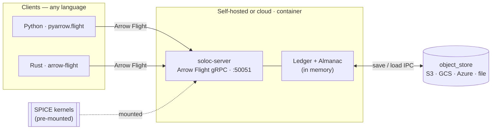

# soloc-server

**The network face of [soloc](../../).** An [Arrow Flight](https://arrow.apache.org/docs/format/Flight.html)
gRPC server (tonic + arrow-flight) that hosts a single [`soloc-ledger`](../soloc-ledger/) `Ledger`
and an anise `Almanac`, and speaks Arrow to any client in any language. Push observations, query
them back, and reproject to any frame, all over the wire, zero-copy.

## System

The server is a single binary. Point it at a config, mount your SPICE kernels, and it holds a
ledger in memory while persisting to local disk or an object store. It is built to be run in a
container, self-hosted or on a cloud, though **no Dockerfile ships yet** (see roadmap); the shape
below is the intended deployment.



On startup the server loads its ledger from a local path or object-store URL (falling back to an
empty ledger); on `SIGTERM` it drains in-flight work and persists. Configuration is read from
`$SOLOC_CONFIG`, then `./config.toml`, then sensible in-memory defaults:

```toml
# config.toml
[server]
bind = "0.0.0.0:50051"
max_message_size = 67108864               # bytes per gRPC message, each way; default 64 MiB

[storage]
# ledger_url (s3:// gs:// az:// file://) takes priority over ledger_path.
ledger_path = "/var/data/ledger.arrows"
# schema_path = "/var/data/schema.arrow"   # optional zero-row IPC schema for a fresh ledger
id_column = "entity_id"
# memory_limit = "5GB"   # optional: evict the oldest rows past this, keeping each entity's latest

[ephemeris]
kernels = ["/path/to/de440s.bsp", "/path/to/pck11.pca"]
```

Kernels resolve in order: the `kernels` list, then `SOLOC_KERNEL_PATHS` (colon-separated), then
`MetaAlmanac::latest()` (downloads ephemeris and orientation data, cached locally). The
locked ANISE version's default includes an Earth high-precision BPC. With no kernels the
server still accepts observations; transforms requiring ephemeris or orientation data fail.

```bash
# Zero-config: in-memory ledger, entity schema, bound to 0.0.0.0:50051
cargo run --release -p soloc-server

# With kernels mounted (no network at runtime)
SOLOC_KERNEL_PATHS=/path/to/de440s.bsp:/path/to/pck11.pca \
  cargo run --release -p soloc-server
```

### ITRF93 kernel configuration

For ITRF93 transformations, configure a local Earth high-precision binary PCK explicitly.
Include planetary constants for `IAU_EARTH` rotations and SPK ephemerides for changes of
origin, such as Earth → ICRF:

```toml
[ephemeris]
kernels = [
    "/data/kernels/earth_high_prec_snapshot.bpc",
    "/data/kernels/pck11.pca",
    "/data/kernels/de440s.bsp",
]
```

Replace these paths with your local files. For reproducibility, retain a dated snapshot,
its checksum, and its coverage rather than depending on a changing `latest` file. An
Earth BPC may contain predicted orientation as well as observed data; coverage alone is
not an accuracy guarantee. Check each observation epoch, not the server's startup date.
In a Rust caller, `almanac.bpc_domain(3000)` reports the outer interval, while
`almanac.bpc_summary_at_epoch(3000, epoch)` checks an actual segment, including gaps.
The transform engine performs the latter check on every row requiring ITRF93 rotation.

An explicit configuration replaces the default set; a file that failed to load is not
usable data. Inspect startup load errors and the per-transform error, which distinguishes
missing Earth BPC from an uncovered observation epoch. Merely storing Cartesian ITRF93
rows or converting units within ITRF93 needs no kernels. See the core crate's
[frame and data requirements](../spacetimestamp/README.md#itrf93-earth-frame).

### Time values on the wire

JSON fields `epoch_tai_s`, `time_range_tai_s`, and `not_before_tai_s` use TAI seconds
since **1900-01-01 00:00:00 TAI**, matching `hifitime::Epoch::from_tai_seconds` and
`Epoch::to_tai_seconds`. This preserves the existing Flight contract. Arrow row
`duration_centuries` and `duration_ns` instead use the J2000 reference in their declared
timescale; the ledger normalizes them to TAI on append. For example,
`2025-01-01T00:00:00Z` is JSON `3944678437` TAI seconds and a stored Arrow offset of
`(0, 788961637000000000)` from J2000 TAI. Query bounds and the current-state cutoff are
inclusive. JSON floating-point seconds cannot preserve every nanosecond; the Arrow integer
fields retain that precision.

## A simple use case

Any Arrow Flight client works. Here is `pyarrow.flight`:

```python
import pyarrow.flight as fl
import json

client = fl.FlightClient("grpc://localhost:50051")

# Push observations. There is no frame-registration step: a frame exists the moment a row
# declares it, and the server derives the parent edge from the data. Cycles and unreachable
# parent frames are rejected at append time.
writer, _ = client.do_put(fl.FlightDescriptor.for_path(["obs"]), batch.schema)
writer.write_batch(batch)
writer.close()

# "Where is everything now?", restricted to specific entities. Ids may be given as the
# (authority, name) they mint from, an astronomical (ephemeris_id, orientation_id) pair, or raw hex.
ticket = fl.Ticket(json.dumps({
    "query_type": "current_state",
    "entity_ids": [
        {"authority": "acme.com", "name": "radar_boresight"},
        {"ephemeris_id": 399, "orientation_id": 399},
    ],
}).encode())
table = client.do_get(ticket).read_all()

# Reproject to another frame for visualization (target_units is a soloc.length_unit code; 1 = km).
writer, reader = client.do_exchange(
    fl.FlightDescriptor.for_command(json.dumps({"target_frame": "GCRF", "target_units": 1}).encode())
)
writer.write_batch(batch)
writer.done_writing()
transformed = next(reader).data
```

## Batched GPX import

Enable this crate's `gpx` feature to use `soloc_server::gpx::submit_batch` with
`spacetimestamp::gps::gpx::import_gpx_async`. The importer streams the input and
awaits each batch submission before continuing. The helper uses the existing
`do_put` endpoint, with **one unsplit Arrow batch per request**. It checks the exact
protobuf size of every message, including the schema, against your supplied
`max_message_size` and applies that cap to the client too. Set it to the server's
configured cap or less; the server's default is 67,108,864 bytes (64 MiB). If a
message is too large, that batch is rejected before any RPC; reduce `max_rows`
explicitly or raise the cap on both sides.

```rust,ignore
use soloc_server::gpx::submit_batch;
use spacetimestamp::gps::gpx::import_gpx_async;

let report = import_gpx_async(
    reader, &mapper, &almanac, options,
    |batch| submit_batch(client.clone(), batch, 67_108_864),
    |event| { /* stream context/assumptions to your audit output */ },
).await;
```

A successful response, including its final stream status, confirms that batch was
appended. `report.submitted` counts these acknowledged rows. Earlier requests remain
accepted after a later failure. Encoding and size failures count as rejected; every
RPC error counts the current batch as **uncertain**, because this protocol supplies
no commit receipt. It may already have been appended. The importer stops and does
not retry, and reports the batch's first/last source positions. A malformed file
can also stop the import after earlier batches were accepted; any buffered rows
are reported as unsubmitted and are not flushed after that error.

Reimporting a file appends its observations again, preserving duplicates. There is
no import ID, deduplication, rollback or whole-file transaction. Reconcile uncertain
rows before a manual retry. Acknowledgement is also separate from persistence:
use the existing save/shutdown facilities when durable storage is required.

For complete-route replay, omit `storage.memory_limit` on the server or provision
and verify sufficient retention. A memory cap can permanently evict old history
while preserving each entity's latest row; small import batches do not prevent
this. The integration tests use an in-memory server with no cap and query every
imported observation back through Flight.

The included example maps explicitly listed tracks/routes to one supplied entity
and receiver, requires recorded timestamps, declares conventional local ENU axes
and approximate ITRF93 output, and rejects waypoints and unmapped objects. Its
required `--ellipsoidal-elevation` flag declares that `<ele>` is WGS84 ellipsoidal
height; select another production mapping policy for other height datums.

Start the normal server, then run this from the repository root against the
synthetic six-point test fixture:

```bash
cargo run -p soloc-server --example import_gpx --features gpx -- \
  http://localhost:50051 \
  crates/spacetimestamp/tests/fixtures/gpx/multiple_objects.gpx \
  example.org fixture-vessel fixture-receiver 2 67108864 \
  --ellipsoidal-elevation route:1 track:1 track:2 \
  2>gpx-import-context.log
```

The example prints the bounded report to stdout, streams original context,
metadata, segment boundaries and mapping assumptions to stderr, and exits with an
error if the import is incomplete. Keep that context log and the original file;
the entity schema does not store GPX metadata or segment gaps. For Earth-relative
rendering and gap-aware playback, use the [playback exporter](../soloc-ledger/README.md#earth-relative-gpx-playback-export)
and [visualizer](../../visualizer/README.md#gpx-playback-with-a-positioned-earth).

## Roadmap

- [x] **Proof-of-concept demo complete** — Flight `do_get` / `do_put` / `do_exchange` plus the
  federation and lifecycle actions, over object-store-backed persistence
- [ ] **Work with end users to implement desired features** — driven by real deployments
- [ ] **Dockerfile & deployment manifests** — ship the containerized shape the diagram implies

## License

Apache-2.0. See the [workspace README](../../) for the ecosystem overview.
