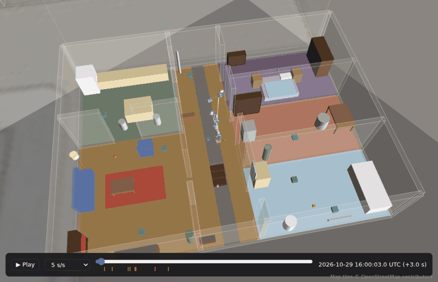
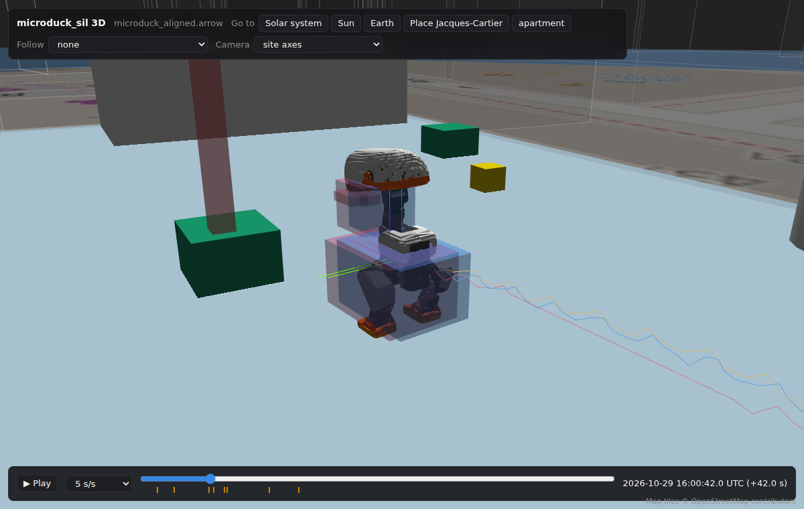
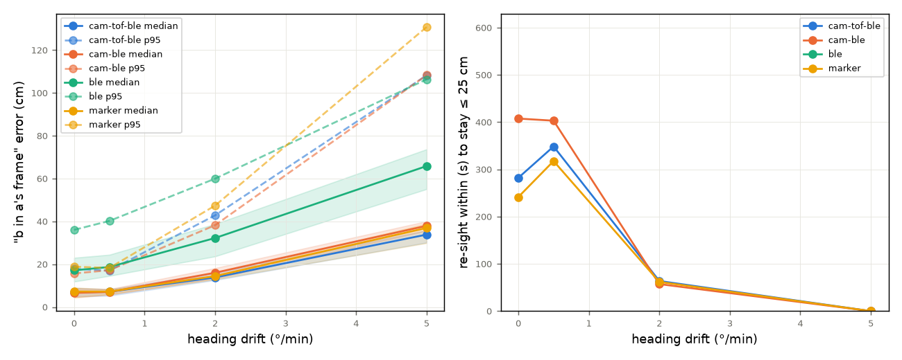
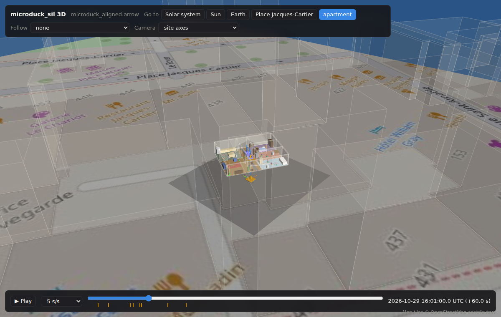

# What does a microduck need to know where its friends are?

Microduck's social behaviours (greeting, follow-the-leader) need to answer "where is duck b in my frame?". Each
duck's odometry starts wherever it booted, with no magnetometer to tie headings together, so
something has to sense the other ducks. We ran Pollen's own digital twin alongside Soloc to perform an initial detector requirements study.

## Setup

- `duck-sim` with four ducks in the `apartment` scene, real `robotd`, velstand walking. Each duck is given a mission to patrol a room
  and point out virtual trash.
- Recorded: MuJoCo truth, each duck's raw odometry in its own boot frame, joint angles at 50 Hz.
- Afterwards, the recording is replayed through the scene to find, at each moment, which pairs had
  a clear line of sight and whether one duck's VL53L5CX zones (`tof.py` model) landed on the
  other duck.
- Four detector designs with parameters: range, field of view, rate, noise & heading drift. 44 designs × 10 noise seeds × 2 runs in total were simulated. Each duck's frame is fitted into a lookout's
  from sightings, and "b in a's frame" is scored against truth every second.

## Findings

| Design | Median error | p95 | Coverage | All ducks aligned by |
|---|---|---|---|---|
| Camera + ToF + BLE | 7 cm | 17 cm | 81% | 120 s |
| Camera + BLE (bearing only) | 7 cm | 17 cm | 67% | 120 s |
| Camera + marker on each duck | 7 cm | 18 cm | 82% | 80 s |
| BLE RSSI only (σ 1 m) | — | — | 7% | never |

1. **Heading drift sets accuracy.** At 0.5°/min a duck can go ~5 min unseen and
   stay within 25 cm. At 2°/min that drops to about a minute (median 14–16 cm, p95 ~45 cm). At
   5°/min it never stays within 25 cm.
2. **Any camera-based design gives ~7 cm.** Range, field of view, rate and noise mostly change how
   soon and how often there is an estimate. A wide view (90–160°) plus any range source reaches
   90% coverage with everyone aligned in 30–40 s; bearing-only stays at 77–79%.
3. **BLE RSSI alone doesn't determine the frames** at realistic noise. Use BLE for identity instead of pose determination.

## What it suggests

- Spend on heading first: gyro bias calibration or a magnetometer, aiming under ~1°/min
- Then a wide-angle camera detector, any range source (ToF or a marker), and BLE for identity
- With 2°/min of drift, a follower should re-sight its leader about once a minute

## Caveats

- The twin's odometry is better than a real duck's; drift is added as a constant gyro bias
- The camera detection curve is assumed
- Run 2 repeats some of run 1's early encounters; it's one flat and one mission

## How it was done

Everything is recorded into [soloc](https://github.com/PhenomenaRL/soloc), a ledger of positions where every row
stays in the frame it was measured in. The apartment is a frame on a 2nd floor in Old Montreal,
and soloc resolves duck → apartment → site → Earth.
One recording fed all 44 designs after the fact: each design is its own set of frames in its own
ledger, and all of them merge into one for viewing and analysis.

